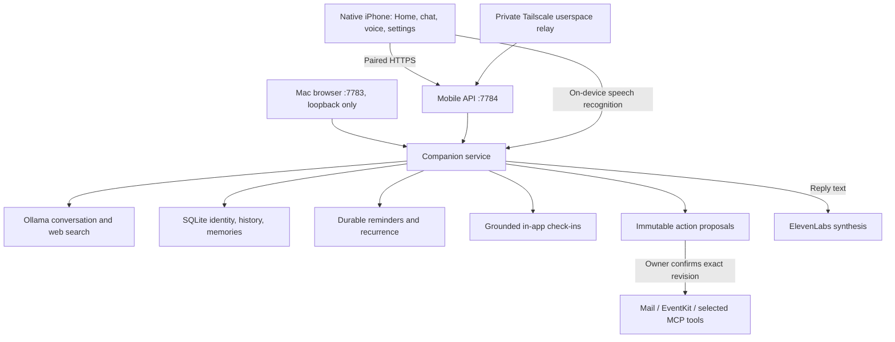

# Glashaus assistant architecture

The existing companion is the shared core: identity, memory and conversation remain the same across web, iPhone and voice. This private Mac/iPhone implementation adds useful actions and contextual initiative. Native push is deliberately deferred. Current acceptance evidence is in [docs/COMPLETION.md](docs/COMPLETION.md), and startup/recovery is in [docs/OPERATIONS.md](docs/OPERATIONS.md).

## Current components

`app/server/companion.ts` builds the persona, local-time, memory and current-capability context. Historical replies cannot redefine current service access. `actions.ts` exposes bounded tool calls, and buffers planning text until tool results arrive so it does not stream speculative claims of completion. Search fetches only public URLs returned in the current turn. Provider reads, emails, events and connector outputs are untrusted data, not permission to act.

## Authority and persistence

The model can search, read configured sources and prepare proposals. It has no confirmation tool. Requested reminders need one-tap confirmation of their title and exact time. Email sends, supported calendar changes and connector writes require review of an immutable proposal in Home. Connection-setting revisions and action revisions invalidate stale approvals.

External action states are `draft → executing → complete`, with `cancelled` and `unknown` outcomes. The service durably records `executing` before the external call. A lost result or interrupted process becomes unknown and is never blindly retried. The UI directs the owner to check the destination. Calendar create uses an action marker; updates/deletes compare the event modification stamp. Reset cannot resurrect a deleted proposal after an asynchronous provider response.

SQLite schema 7 stores existing companion records plus reminder recurrence and reviewed actions. Archive schema 6 includes those records while excluding provider credentials and phone sessions. Import pauses schedules, disables outreach, expires unseen check-ins and cancels unapproved proposals. A restore drill checks the exported archive in a separate temporary database before marking a backup verified.

Reminders support daily, weekdays, weekly and monthly recurrence using wall-clock anchors and IANA zones. A monthly 31st returns to the 31st after a shorter month. A DST gap moves forward; a repeated hour uses the first occurrence. Completion advances to the next future occurrence; missed occurrences do not generate a burst of reminders. These are internal Glashaus reminders, not Apple Reminders or calendar events.

Check-ins use recent actual conversation, explicit provenance, a daily cap, local outreach hours and cadence gaps. The model may choose silence. Current owner preferences are 9 am–9 pm, at most two daily, two hours after conversation and four hours between check-ins. They appear in the foreground app; no closed-app delivery is implied.

## Native client and transport

SwiftUI targets iPhone, preserving native navigation, scalable type and the compact Terminal Pastoralism design. Home collects real pending work and routes to chat, voice, reminders, calendar and inbox. Background presets are local appearance choices. Clear chat view is a reversible, companion-scoped preference on the iPhone; shared conversation and memories remain intact, and pending retries are preserved.

A single-use, five-minute pairing link carries a private address, one-use code and the certificate fingerprint. The phone stores its token/pin in Keychain; the Mac stores a token hash. HTTPS uses TLS 1.2 or newer and exact certificate pinning plus X.509 validity checks. Both URLSession data and byte-stream APIs explicitly receive the trust delegate. Redirects are rejected. The iOS ATS exception is scoped to Tailscale's `100.64.0.0/10` range for the private trust anchor; the application still requires HTTPS and the correct pin.

Recent snapshots and pending messages use protected iPhone files excluded from backup. Offline views identify cached content. A changed address is tested against the same certificate and companion before credentials are saved. A pending failed reply may survive address recovery; changing to an entirely different pairing still requires resolving it. Revocation blocks new requests and active streams, but cannot erase an offline phone remotely.

The current Mac uses WARP for internet and a separate userspace Tailscale node for private Glashaus access. That node forwards only port 7784 and leaves DNS and the Mac VPN tunnel alone. An explicit relay-only diagnostic setting currently avoids an unstable direct path through WARP; the owner confirmed address save and a reply on this route. This is a documented environment workaround, not a general claim that arbitrary VPN combinations are supported. The browser admin API remains loopback-only.

## Account adapters and voice

- **Mail:** IMAP/TLS inbox reads and plain-text message parsing, no mark-read side effect, no remote image loading; SMTP/TLS for exact reviewed recipient/subject/body sends. Apple app-specific credentials are required.
- **Calendar:** a small Mac EventKit helper reads selected calendars/events. Preview obtains the actual account/calendar, before-state and overlapping selected events. Supported create/update/delete requires review. Existing all-day events, recurring series and invitations stay in Apple Calendar. This adapter is Mac-specific; Linux/Windows calendar parity is not implemented.
- **MCP:** Streamable HTTP endpoints use explicit per-tool selection. Owner-selected reads may run directly; other selected tools need proposals. Server annotations do not grant permission. OAuth, stdio transports and automatic tool grants are not implemented.
- **Voice:** iPhone on-device speech recognition feeds the normal companion pipeline. Completed reply text goes to ElevenLabs; the phone plays its MP3 and resumes listening. Silence submits a turn; manual Interrupt cancels generation/playback. Backgrounding or audio-route interruption stops capture. Synthesis is currently buffered per reply, not progressive playback of partial model sentences. Custom Voice Design voices are supported. Custom-rate voices are excluded and checked again before synthesis, alongside included allowance and a local monthly character reservation. No audio files are persisted by Glashaus.

Account credentials reside in the private Mac SQLite home and are omitted from public responses/archives. They are not individually encrypted by a Keychain vault. The phone never receives the provider keys. Conversation/model access and requested source content use the configured hosted provider; reply text also reaches ElevenLabs. Provider account retention settings remain applicable.

## Operation and remaining acceptance

macOS launchd starts the host at sign-in, preserves both ports and restarts failures. The private network has its own user agent. Background handoff, network restart, database integrity and isolated archive restore have passed. A sleeping or logged-out host is unavailable; the app does not override lid-close or macOS power behavior.

Owner-confirmed results include live mail/calendar reads, Read with Elle, the custom Elle voice preview and private-address chat with WARP on. Remaining acceptance includes a full spoken conversation, reviewed real account writes, complete accessibility review, reboot/sleep-wake and longer everyday-use trials. A future Mac mini gets a fresh imported home, account permissions and pairing; only one primary scheduler should be active. The original installed companion and its data remain separate from this development home.
