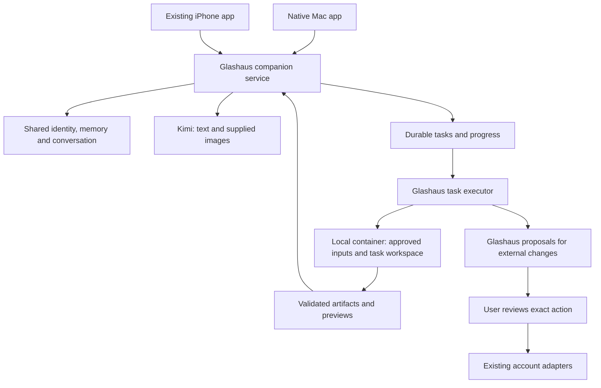

# Glashaus desktop and agent expansion

September 29, 2026 · Implementation authorized; in progress · Baseline: `a61c2c79561ed78177f24a36c756a447b4f80ddb`

## Product outcome

Keep the same companion across iPhone and Mac, and give her a workspace where she can understand supplied material, do useful work and return real files. The owner wants a launchable Mac app distributed as a DMG, code execution, broader tools, document generation and image understanding. This continues the life-management/companion product.

Confirmed for this phase:

- Run the first code sandbox on this Mac, using a container runtime, rather than buying cloud execution.
- Prove **photo → useful plan → PDF/DOCX** first.
- Preserve the accepted compact Terminal Pastoralism identity, shared conversation, memories, custom ElevenLabs voice and working iPhone connection.
- Existing policy remains: review every email send and Calendar change. Native push is still deferred. The $25/month voice budget does not authorize other provider subscriptions.

The exact desktop composition and container product remain to be selected. No Hermes installer, computer-control driver or container runtime was run during this research.

## Existing foundations and the real gaps

Glashaus already calls model tools, searches the web, reads connected sources and prepares immutable external-action proposals. The current implementation is deliberately sized for short assistant requests:

- `app/server/companion.ts`: three tool rounds, six calls and a two-minute action deadline; conversation processing is serialized.
- `app/server/connectors.ts`: Streamable HTTP MCP, selected tools, explicit read grants and a 25-second operation deadline.
- `app/server/ollama.ts`: the provider message already permits `images`, but the phone, attachment storage and conversation submission path do not provide a complete image flow.
- Existing database jobs support companion housekeeping. They are not yet a user-visible task system with files, streamed progress and cross-client cancellation.

Do not turn a long report into a two-minute connector call or increase every limit and call that an agent system. Introduce durable task admission, independent execution and an artifact library. A lengthy task must not prevent ordinary conversation with Elle.

## What to reuse from Hermes

Reviewed upstream revision: [`5000e29936df69d5209f7cf2eea8e5776cb4cbb1`](https://github.com/NousResearch/hermes-agent/tree/5000e29936df69d5209f7cf2eea8e5776cb4cbb1). This is a research reference, not a tested integration or automatic dependency selection.

| Capability found upstream | Glashaus application |
| --- | --- |
| [Programmatic run API](https://hermes-agent.nousresearch.com/docs/developer-guide/programmatic-integration): status, event stream, approval and stop | Candidate interface for bounded work assigned by Glashaus |
| [Terminal/file tools, background processes and execution backends](https://hermes-agent.nousresearch.com/docs/user-guide/features/tools) | Calculations, file transformations and longer research/document tasks |
| [PDF helpers](https://github.com/NousResearch/hermes-agent/blob/5000e29936df69d5209f7cf2eea8e5776cb4cbb1/skills/productivity/pdf/SKILL.md) | Generate, inspect and preview PDFs |
| [DOCX helpers](https://github.com/NousResearch/hermes-agent/blob/5000e29936df69d5209f7cf2eea8e5776cb4cbb1/skills/productivity/docx/SKILL.md) | Editable documents, templates and validation |
| Browser automation and reusable skills | Research, repeatable household workflows and supervised website tasks |
| [Computer use through cua-driver](https://hermes-agent.nousresearch.com/docs/user-guide/features/computer-use) | Later, narrowly selected Mac application workflows |

The repository and the inspected PDF/DOCX skill licenses are MIT. Preserve their notices when reusing code, and check each packaged dependency's license separately. Owner correction: do not delegate tasks to Hermes or run Hermes as the default agent. Glashaus owns planning, task execution, permission enforcement and results. Adapt selected upstream patterns or document helper code into Glashaus with attribution; no Hermes daemon dependency.

Hermes' inspected `agent/transports/hermes_tools_mcp_server.py` is a curated stdio bridge for a different host. It excludes terminal/file/process tools and does not expose the full agent. Glashaus currently supports HTTP MCP. Adding its URL in Settings will not deliver the requested system.

Likewise, `execute_code` is an execution mechanism, not proof of isolation: its local mode uses a child kernel. The chosen container backend, mounts, credentials and network policy must establish the actual boundary. Upstream documents a container shared across a Hermes process; isolate Glashaus task workspaces explicitly rather than assuming each call gets a fresh container.

## Recommended architecture

Glashaus owns the relationship, user-facing history, permissions, schedules and file library. A Glashaus task worker receives the specific task and selected context; its execution transcript is task evidence. It does not become a second companion memory store or start its own unrelated outreach. Elle returns the result in the existing conversation with links to the files and a clear record of what succeeded.

Implement these contracts directly in Glashaus: task admission, progress, interruption, approval and reconnect. Upstream run APIs are design references only.

## Desktop product

Recommended stack: a native SwiftUI macOS app, sharing appropriate models/networking and visual tokens with iOS, with the existing Node service packaged as a managed helper. Native navigation, drag/drop, file pickers, previews, keyboard shortcuts and menu-bar access matter more here than embedding the existing administration page.

Proposed information architecture, to visualize before UI implementation:

- **Home:** today's commitments, work needing review and recent useful results.
- **Conversation:** the same Elle; add images/files, use voice and open task progress without leaving the exchange.
- **Library:** original inputs and generated documents, with previews, versions, sources, Save As and Share.
- **Tasks:** running, waiting for input/review, completed, interrupted and failed work. Progress is a real state, never a decorative percentage.
- **Settings:** accounts, permissions, voice, appearance, storage and service recovery.

A desktop conversation can place an artifact preview alongside its messages. On iPhone, the same artifact opens in a native sheet with sharing. Keep healthy service details out of persistent chat chrome. Retain the established palette, quiet artwork and compact controls; the new desktop layout still needs a visual concept decision through Impeccable/Product Design.

The DMG should contain `Glashaus.app`, with its required runtime and production dependencies available without a source checkout or development server. Container support can be a guided optional component enabled when execution is first requested. Store user data outside the app bundle. Adopt the existing companion home and service through a verified handoff; preserve pairing, certificate and data, and prevent two schedulers from running.

Closing the window should leave the existing host available to the phone. Make stopping the host an explicit, understandable action. Test launch after installation, quit/reopen, sign-in startup, application replacement and rollback on a clean Mac account. A later Mac mini can remain the host while the laptop app becomes a paired client.

A private development `.app`/`.dmg` is feasible before paying Apple. A downloadable distribution with Developer ID signing and notarization is a separate delivery gate requiring the appropriate Apple membership. Creating a disk image alone does not satisfy that gate. See [Apple's Developer ID guidance](https://developer.apple.com/help/account/certificates/create-developer-id-certificates). Do not promise a frictionless public installer from a free Personal Team build.

## Attachments, image understanding and files

[Ollama lists Kimi K2.6 with image input](https://ollama.com/library/kimi-k2.6); its [vision API](https://docs.ollama.com/capabilities/vision) accepts image data alongside text. Start with photo selection/paste/drop on Mac and the native photo picker on iPhone. Preserve orientation, bound resolution/size, remove unnecessary location metadata from the model copy, and keep original files outside SQLite with stable attachment IDs.

Do not treat a photo as infallible structured data. Ask about unreadable text, ambiguous ingredients, quantities or user preferences. Keep source references so a user can see what a plan was based on. Sending an image to the configured cloud model is a data transfer; the upload flow should make the destination understandable.

For artifacts, start with PDF and editable DOCX, then CSV/XLSX, charts and presentations. Each artifact needs an ID, type, filename, hash, source task, version, creation time and preview state. Model prose containing a filename is not a deliverable. A result becomes available only after the host imports the output, validates its type/path/size and verifies that it opens.

Render representative PDF pages and a DOCX preview; inspect layout as well as extracted text. DOCX rendering needs a real renderer in addition to `python-docx`. Preserve editable source and prior versions when the user requests revisions. Downloads use the existing paired-device authentication and support iPhone Files/share. Extend archive export/import and deletion semantics to cover the new files before calling the library complete.

## Execution and permissions

The owner chose local execution. Select a maintained Mac container runtime after checking compatibility and installation requirements. Run task code with bounded CPU, memory, disk, time and output; mount only the task's copied inputs and output folder. Do not mount the user's home, Glashaus database, Keychain, host Docker socket or provider credential files into arbitrary code. Enforce network access at the runtime boundary; keep model/account calls behind the host's capability broker. A working-directory setting is not a sandbox.

Generating a new file inside the requested task workspace should proceed without repeated confirmation. Reading new folders needs an explicit selection; replacing originals needs an exact preview. Existing email/Calendar writes still pass through Glashaus proposals. A Hermes shell or browser must not become an alternate route around those rules.

Separate browser profiles and later Mac-control permissions from the calculation/document sandbox. Computer use is opt-in for selected tasks and must stop promptly. The worker should have neither automatic personal-browser login access nor authority to approve its own prompts. Packaging a signed control helper and testing macOS permission attribution matters given the Calendar helper issue already encountered.

Task records should distinguish queued, running, waiting for user, stopping, completed, failed, cancelled and interrupted. Persist step receipts, inputs, policy grants and output IDs. A crashed worker does not mean its task succeeded. Reconcile after restart; never blindly repeat an external write whose result was lost. Set explicit per-task time/tool/model budgets, show usage when available and start with one execution job at a time to keep conversation responsive.

## Delivery order and acceptance

| Stage | Deliverable | Proof required |
| --- | --- | --- |
| 1. Desktop foundation and integration spike | Native app shell, shared host contract, isolated Glashaus/container experiment | Same companion from both devices; one scheduler; worker progress/cancel/approval works; no live account writes |
| 2. Images and file intake | Mac/iPhone attachments and Kimi vision, stored originals and source references | Real photo round trip; unclear image handled honestly; reconnect does not duplicate uploads |
| 3. First useful artifact | Durable job + local document tools + PDF/DOCX preview, revision and sharing | Photo → plan → two real files; both open and match; revise without losing earlier version; reopen from the other device |
| 4. Mac distribution | Bundled runtime, install/migrate/update/recovery, DMG | Clean account install, existing-home handoff, restart and rollback; signing/notarization separately verified when membership exists |
| 5. Broader useful work | Document extraction, spreadsheets/charts, browser research, scoped file search and saved routines | Source-backed results; selected-folder boundaries; reviewed website/account changes; task survives client disconnect |
| 6. Computer management | Selected Mac app actions, then optional integrations such as Home Assistant | Real permission/revocation, visible scope and reliable stop; no replacement for existing direct Calendar/mail adapters |

The first release milestone includes stages 1–4. A useful demonstration is a pantry photo turned into a dinner plan and shopping list, delivered as PDF and editable DOCX. It is an example fixture, not permission to infer dietary preferences or schedule/send anything. A follow-up such as “make it for two people” must produce a new file version and preserve the original.

Keep the current working installation usable while developing this expansion. Use synthetic images and a separate task/data home for initial tests. The existing 108 backend tests, browser suites and native regression scenarios remain the baseline; add meaningful coverage for attachment authorization, sandbox escapes, cancellation, interrupted jobs, artifact recovery and desktop migration.

## Decisions still needed before their dependent work

- The desktop composition, shown using the established visual world rather than silently inventing a replacement.
- The local container runtime; installing it may require a user-facing system permission.
- Whether and when to obtain Apple membership for notarized distribution; no purchase is assumed.
- Any optional paid browser/image-generation service budget. The first milestone does not require enrolling in one.

The first two product choices—local execution and photo-to-document acceptance—are settled. This document records the implementation direction; it does not claim that the new desktop, sandbox, image flow or artifact library already ships.
